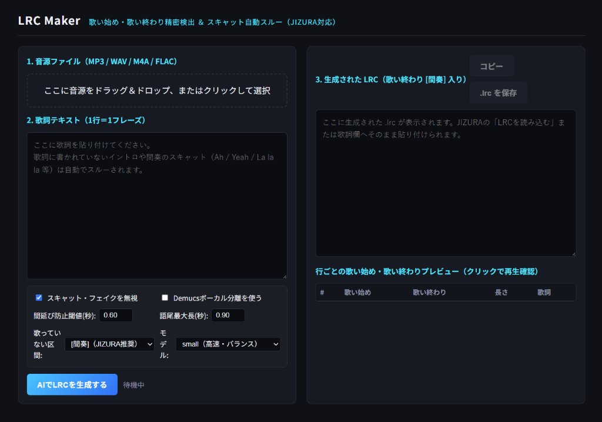

# LRC Maker

音源と歌詞テキストから、歌い始め・歌い終わりのタイムスタンプ付き `.lrc` ファイルを生成するツールです。
JIZURA で読み込んだ際に歌っていない区間まで歌詞が残らないよう、歌い終わりを検出して `[間奏]` タグ（または空行）を挿入する処理に対応しています。



## 主な機能

- **Forced Alignment（`stable-ts`）による歌詞同期**: 入力した歌詞テキストを書き換えずに、各行・各文字の発声タイミングを割り当てます。
- **歌い終わり（リリース）の検出と間延び防止**: ボーカル帯域（220Hz〜3800Hz・センター定位成分）の RMS エンベロープ解析と語尾最大長の制限により、歌い終わりを検出します。次の行まで一定以上の空白がある場合は `[間奏]` タグを挿入し、歌詞の間延びを抑えます。
- **スキャット・非歌詞区間のスルー**: 事前認識結果と歌詞テキストの文字一致率を比較し、歌詞に含まれないスキャット（Ah / Yeah / La la la 等）の区間を減衰させてからアライメントを実行します。また、行頭・行末の孤立トークン補正により誤吸着を軽減します。
- **Demucs ボーカル分離（任意）**: 2ミックス音源からボーカルステムを分離してからアライメントを行うオプションをサポートしています。

## 起動方法

### Web UI モード（ブラウザ操作）

`start.bat` をダブルクリックするか、以下のコマンドを実行すると `http://127.0.0.1:7865` でブラウザ画面が開きます。

```powershell
.\.venv\Scripts\python.exe app.py
```

### CLI モード（コマンドライン）

```powershell
.\.venv\Scripts\python.exe app.py --audio song.mp3 --lyrics lyrics.txt -o song.lrc
```

オプション一覧:
- `--model`: Whisperモデル名（`small`, `medium`, `large-v3-turbo`）
- `--demucs`: Demucs でボーカル分離を行ってからアライメントを実行
- `--gap`: `[間奏]` タグを挿入する最小空白秒数（デフォルト: `0.60`）
- `--tail`: 語尾1文字の最大持続秒数（デフォルト: `0.90`）
- `--tag`: 歌っていない区間に挿入するタグ（デフォルト: `[間奏]`）

